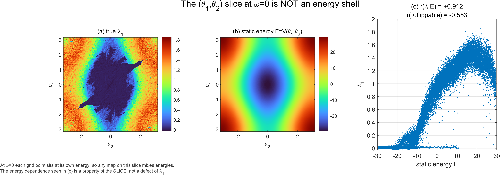

# Double Pendulum Chaos Lab

A reproducible MATLAB research toolkit for exploring chaos in the double pendulum and the forced damped pendulum. The project combines a fast generator, interpretable scientific figures, interactive exploration, and tests that check numerical methods against independent properties.

<p align="center">
  
</p>

<p align="center"><b>One phase-space slice. Three views. A direct check that energy is not the chaos indicator.</b></p>

## Start here

- **[Open the visual project guide](index.html)** for the results gallery, generator workflow, and figure-reading notes.
- **[Read the scientific report](dp_v2/report.html)** for the model, methods, results, limitations, and interpretation.
- **[Browse the API manual](dp_v2/manual.html)** for function signatures and options.
- **[Use the quick reference](dp_v2/README.md)** for setup and MATLAB commands.

The report and API manual are self-contained HTML documents generated from source data and the gallery. Their figures are embedded, so they work offline once generated.

## What makes this project useful

- **A generator you can actually iterate on.** `make_gallery('N',200)` computes and archives results; `make_gallery('N',200,'figuresOnly',true)` redraws from cached `.mat` data without repeating expensive integration.
- **The measured quantity is the quantity shown.** Chaos maps use the largest Lyapunov exponent from variational equations, not an amplitude proxy.
- **Different systems get different diagnostics.** The double pendulum uses its four-dimensional tangent dynamics; the forced two-dimensional system is read with both Lyapunov and winding-number maps.
- **Validation is part of the workflow.** MATLAB test suites cover analytical checks, convergence, symplectic structure, literature figures, and optimized-vs-reference implementations.

## Generate the figures and guide

Requirements: MATLAB (the project documentation targets R2021a or later) and Python with SciPy for rebuilding the HTML documents.

```matlab
cd dp_v2
addpath(genpath(pwd))

% Verify the numerical package before trusting or regenerating results
run_all_tests

% Build the full scientific gallery (expensive; runtime depends on hardware)
make_gallery('N',200)

% Iterate on presentation using cached numerical results
make_gallery('N',200,'figuresOnly',true)
```

Then, from the repository root:

```bash
python dp_v2/gen/gen_report.py
python dp_v2/gen/gen_manual.py
python dp_v2/gen/verify_manual.py
```

The report generators deliberately fail if required `gallery/summary.mat` fields are missing. A stale or incomplete result bundle must not silently become hard-coded claims.

## Reading the figures

- `dp_lyapunov_map.png`: largest Lyapunov exponent over the double-pendulum initial-angle slice. The slice fixes both initial angular velocities to zero; it is not a constant-energy shell.
- `dp_energy_compare.png`: the Lyapunov map, static potential, and their pointwise relationship. This makes slice-induced energy correlation visible rather than hiding it.
- `fp_lyapunov_map.png` and `fp_winding_map.png`: paired views of the forced damped pendulum. At strongly supercritical forcing, Lyapunov values can be spatially similar while winding basins retain visible structure.
- `fp_basin_dimension.png`: uncertainty-exponent scaling for the basin boundary; interpret only when the grid resolves a usable scaling range.
- `sp_energy_*.png`: long-time energy behavior for symplectic schemes and RK4. The comparison concerns boundedness/drift, not a claim that every symplectic step is more accurate.
- `sp_henon_*.png` and `sp_mathieu_bands.png`: literature-linked tests and stability structure from the symplectic indicator suite.

The images are scientific outputs, not decorative illustrations. Read captions and the report's limitations before interpreting color or class boundaries. A finite-time Lyapunov estimate near zero can have either sign, and a positive value alone is not a chaos classifier.

## Repository map

```text
dp_v2/
  core/       ODE, variational, canonical and symplectic integrators
  maps/       initial-condition maps and literature reproductions
  analysis/   comparisons, basin dimension and parameter studies
  gui/        interactive MATLAB laboratories
  gen/        symbolic-code and HTML documentation generators
  tests/      numerical, structural and regression checks
  gallery/    published figures and compact result data
  docs/       performance calibration and implementation notes
```

Legacy scripts and historical output are retained for provenance, but the maintained generator and curated results live in `dp_v2/`. Temporary caches, Python bytecode, and redundant video frames are not part of the curated results gallery.

## Scientific guardrails

This repository distinguishes the double pendulum (a four-dimensional conservative system) from the periodically forced damped pendulum (a two-dimensional dissipative flow). Indicator choice follows system dimension. The forced pendulum's winding map identifies attractor basins; the Lyapunov map answers a different question. The double-pendulum angle slice mixes energies, and its correlation with static potential is therefore not evidence that energy determines chaos.

See the full [report](dp_v2/report.html) for equations, parameter conventions, measured limitations, and reproducibility details.
